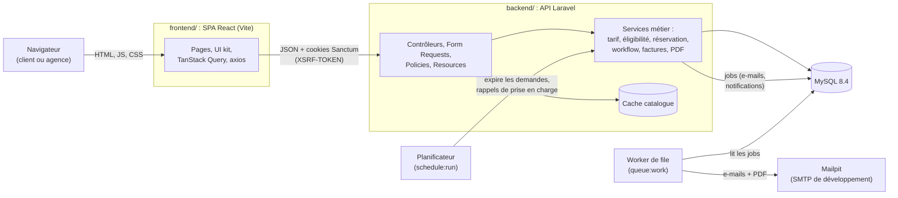
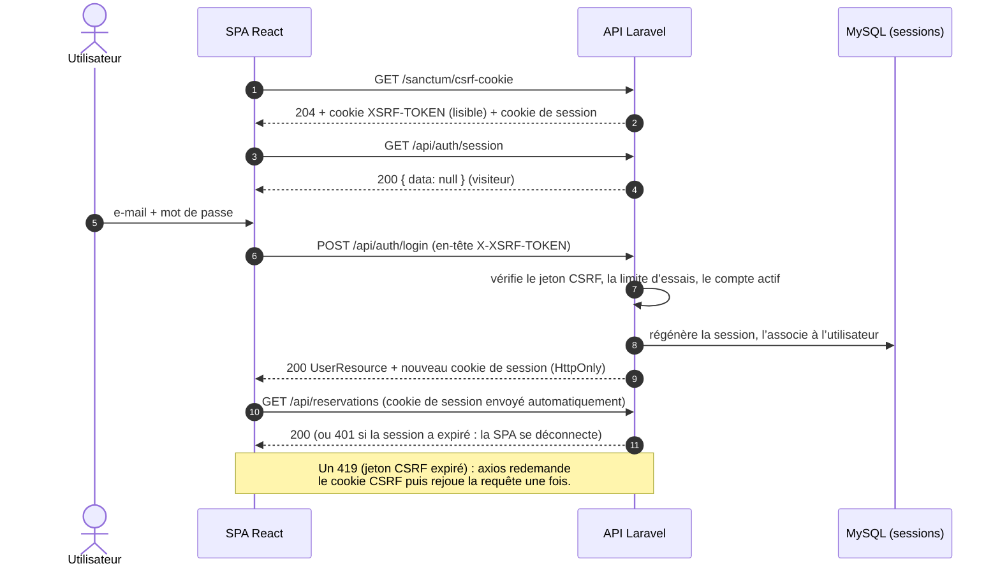
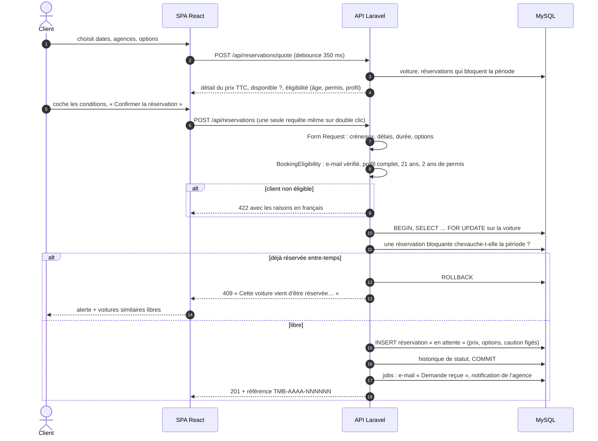
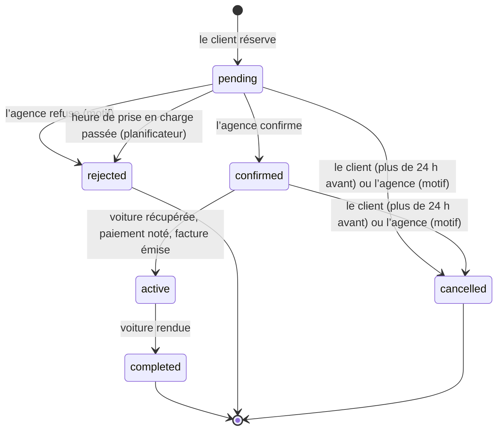
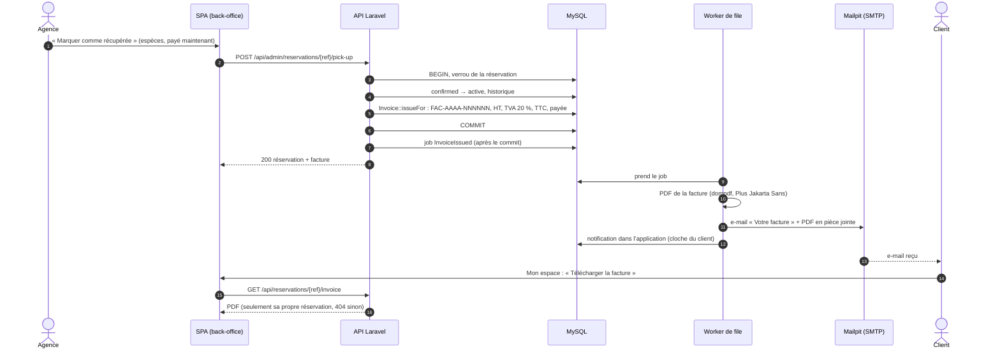

# Architecture de Tomobilti

Tomobilti est découpé en deux applications indépendantes qui ne partagent qu’un contrat
HTTP (du JSON sous `/api/*`) : une application monopage React et une API Laravel. Ce
document décrit leur organisation et les quatre mécanismes clés : l’authentification, la
réservation, le cycle de vie d’une réservation et la facturation avec ses e-mails.

Les détails de chaque route sont dans [api.md](api.md), le schéma de la base dans
[database.md](database.md), la sécurité dans [security.md](security.md).

## 1. Vue d’ensemble

- **SPA React** (`frontend/`) : l’interface en français. Elle ne calcule jamais un prix
  ni une disponibilité : elle envoie les choix du client et affiche la réponse du serveur.
  Les données passent par TanStack Query (cache, rechargement, états de chargement).
- **API Laravel** (`backend/`) : uniquement du JSON. Chaque entrée est validée par une
  Form Request, chaque action protégée par une Policy, chaque sortie mise en forme par
  une API Resource. Les règles métier vivent dans des services
  (`ReservationPricing`, `BookingEligibility`, `ReservationBooker`, `ReservationWorkflow`,
  `ReservationDocuments`).
- **MySQL** : la seule source de vérité (voitures, réservations, historique des statuts,
  factures, notifications, sessions, file de jobs, cache).
- **Worker de file** : envoie les e-mails et les notifications en arrière-plan, pour que
  l’API réponde vite. Les e-mails partent **après la validation de la transaction**
  (`afterCommit`) : jamais d’e-mail pour une action annulée.
- **Planificateur** : toutes les 5 minutes, refuse les demandes dont l’heure de prise en
  charge est passée ; toutes les 15 minutes, envoie le rappel de la veille.
- **Mailpit** : reçoit tous les e-mails en développement (http://localhost:8025).

## 2. Authentification (cookies Sanctum et CSRF)

- **Pourquoi des cookies et pas des jetons** : le cookie de session est `HttpOnly` (un
  script ne peut pas le lire, donc pas de vol par XSS) et `SameSite=Lax`. Le jeton CSRF
  protège les requêtes qui modifient des données.
- La SPA et l’API sont sur le même site (`localhost`, `tomobilti.ma` /
  `api.tomobilti.ma` en production) : le navigateur partage les cookies. Les domaines de
  la SPA sont déclarés dans `SANCTUM_STATEFUL_DOMAINS` et dans CORS (`FRONTEND_URL`).
- **Limites** : 5 échecs par minute par e-mail et IP, 20 essais par minute par IP. Un
  compte désactivé reçoit un 403 ; sa désactivation supprime ses sessions.
- Au démarrage, la SPA appelle `GET /api/auth/session` (l’utilisateur, ou `null`) : un
  visiteur ne produit pas d’erreur 401 dans la console.

## 3. Réservation (devis, éligibilité, verrou, 409)

- **Le serveur fixe le prix** : `ReservationPricing` calcule jours × prix par jour,
  options (par jour ou par location), frais d’abandon. La SPA n’envoie jamais de prix.
  Les montants sont figés dans la réservation : un changement de tarif ne modifie pas
  les réservations existantes.
- **Pas de double réservation** : la transaction verrouille la ligne de la voiture
  (`lockForUpdate`). Deux clients qui confirment la même voiture au même instant sont
  traités l’un après l’autre ; le second voit la première réservation et reçoit un 409.
- **Côté SPA** : `useSingleFlightMutation` ignore un second clic pendant la requête, et
  le brouillon (dates, options, étape) est gardé dans `sessionStorage`.

## 4. Cycle de vie d’une réservation

| Statut | Libellé | Bloque la voiture |
| --- | --- | --- |
| `pending` | En attente | oui |
| `confirmed` | Confirmée | oui |
| `active` | En cours | oui |
| `completed` | Terminée | non |
| `rejected` | Refusée | non |
| `cancelled` | Annulée | non |

- Les transitions autorisées sont définies une seule fois, dans
  `ReservationStatus::allowedTransitions()`. Toute autre transition répond 403 avec la
  raison en français.
- **Chaque changement passe par `ReservationWorkflow`** : verrou de la ligne, contrôle de
  la transition, date et motif enregistrés, ligne dans `reservation_status_histories`
  avec l’auteur (client, agence ou planificateur). La confirmation revérifie que la
  voiture est toujours libre (409 sinon).
- La SPA de l’agence n’affiche que les boutons permis par le statut
  (`actionsForStatus`, miroir des règles du serveur).

## 5. Facture et e-mails

- **Le paiement a lieu à l’agence**, à la prise en charge : la même transaction passe la
  réservation « en cours » et émet la facture, payée ou à encaisser. Une facture à
  encaisser est marquée payée plus tard depuis `/admin/factures`.
- Les montants de la facture sont TTC, comme réservés ; `Invoice::splitTotal()` calcule
  HT et TVA avec bcmath (pas d’erreur d’arrondi). La facture écrit le montant en lettres
  (exigence marocaine) et tous ses montants au centime (« 1.840,00 DH »).
- Le numéro est séquentiel par année ; en cas de conflit sur l’index unique, l’émission
  est retentée.
- **Chaque événement envoie ses e-mails une seule fois**, après le commit, par
  `ReservationNotifier` : demande reçue, confirmée (avec le bon de réservation PDF),
  refusée, annulée, rappel la veille, facture, remerciement.

## 6. Organisation du code

| Dossier | Rôle |
| --- | --- |
| `backend/app/Http/Controllers` | Contrôleurs fins par zone (`Catalog`, `Auth`, `Reservation`, `Admin`) |
| `backend/app/Http/Requests` | Validation (Form Requests), messages en français |
| `backend/app/Policies` | Qui peut faire quoi (client : ses réservations ; agence : tout) |
| `backend/app/Services` | Règles métier : tarif, éligibilité, réservation, workflow, PDF, cache |
| `backend/app/Notifications` | E-mails et notifications dans l’application |
| `frontend/src/pages` | Une page par route (public, `account`, `booking`, `admin`, `legal`) |
| `frontend/src/components/ui` | UI kit (boutons, champs, dialogues, tableaux…) |
| `frontend/src/hooks`, `src/api` | Accès aux données (TanStack Query + axios) |
| `frontend/src/lib` | Libellés français, règles miroir, formats, animations |
