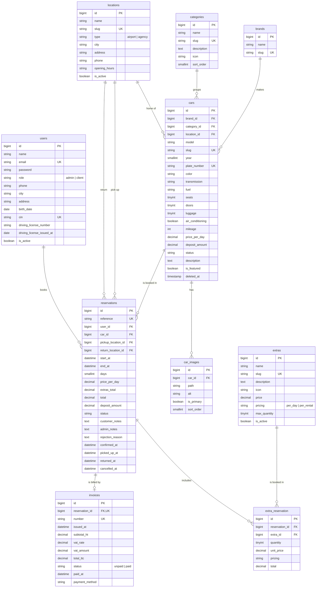
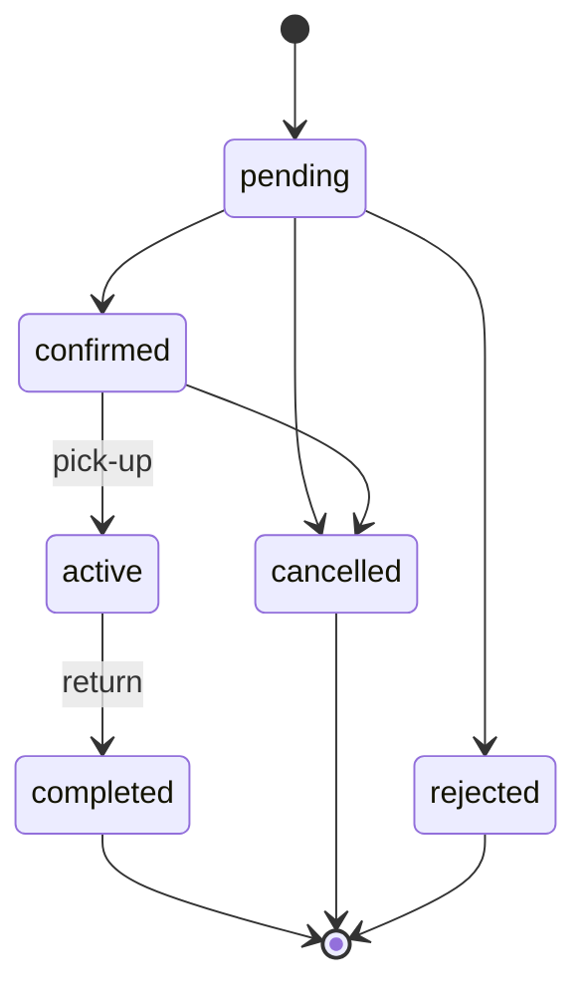

# Base de données

Schema of the Tomobilti API (`backend/`). It runs on **MySQL 8.4** in development (Docker) and on **in-memory SQLite** in tests, so it only uses portable column types:

- Enums are stored as `varchar` strings (no native `ENUM`), cast to PHP enums in `app/Enums`.
- Money is `decimal(10,2)`, cast to `decimal:2` (a string such as `"250.00"`). It is never a float. Amounts are in **MAD**, VAT included (TTC) unless the column says HT.
- Dates of the rental lifecycle are `datetime` in the app timezone (`Africa/Casablanca`).

Migrations: `backend/database/migrations`. Models: `backend/app/Models`. Demo data: `backend/database/seeders`.

## Diagram



Every table also has `created_at` and `updated_at`.

## Tables

### `users`

Accounts of agency staff (`admin`) and customers (`client`). The Laravel default columns are kept; a separate migration adds the customer profile.

| Column                      | Type                                  | Notes                                                                               |
| --------------------------- | ------------------------------------- | ----------------------------------------------------------------------------------- |
| `role`                      | string(20), default `client`, indexed | `UserRole`. **Not mass assignable**, so a registration form cannot create an admin. |
| `phone`                     | string(20), nullable                  | E.164 Moroccan number, e.g. `+212661234567`.                                        |
| `city`, `address`           | string, nullable                      |                                                                                     |
| `birth_date`                | date, nullable                        | Used by the `age` accessor.                                                         |
| `cin`                       | string(20), nullable, unique          | Carte d'identité nationale, e.g. `BE123456`.                                        |
| `driving_license_number`    | string(30), nullable                  |                                                                                     |
| `driving_license_issued_at` | date, nullable                        | `hasValidLicense()` requires at least **2 years** (`User::MIN_LICENSE_YEARS`).      |
| `is_active`                 | boolean, default `true`               | **Not mass assignable**. Disabled accounts.                                         |

Helpers: `isAdmin()`, `isClient()`, `age`, `hasValidLicense(?$onDate)` (pass the pick-up date to check the licence on that day).

### `categories`

Catalogue categories: Économique, Compacte, Berline, SUV, Familiale, Luxe, Utilitaire.

| Column        | Type                 | Notes                                                                                                |
| ------------- | -------------------- | ---------------------------------------------------------------------------------------------------- |
| `name`        | string(100)          | French display name.                                                                                 |
| `slug`        | string(120), unique  | Route key (`/categories/suv`).                                                                       |
| `description` | text, nullable       |                                                                                                      |
| `icon`        | string(50), nullable | [lucide](https://lucide.dev/icons) icon name used by the React app (`wallet`, `car`, `mountain`...). |
| `sort_order`  | smallint, default 0  | Display order.                                                                                       |

### `brands`

Manufacturers (Dacia, Renault, Peugeot...). `name`, `slug` (unique, route key).

### `locations`

Pick-up and return points.

| Column          | Type                    | Notes                                            |
| --------------- | ----------------------- | ------------------------------------------------ |
| `name`          | string(150)             | e.g. "Marrakech Aéroport Menara".                |
| `slug`          | string(170), unique     | Route key.                                       |
| `type`          | string(20)              | `LocationType`: `airport`, `agency`.             |
| `city`          | string(100), indexed    |                                                  |
| `address`       | string                  |                                                  |
| `phone`         | string(20), nullable    |                                                  |
| `opening_hours` | string, nullable        | Free text, e.g. "Tous les jours, 07:00 – 23:00". |
| `is_active`     | boolean, default `true` |                                                  |

### `cars`

The fleet. **Soft deletes**: removing a car from the fleet keeps it for the history of its reservations.

| Column                      | Type                                     | Notes                                                          |
| --------------------------- | ---------------------------------------- | -------------------------------------------------------------- |
| `brand_id`, `category_id`   | FK, restrict on delete                   |                                                                |
| `location_id`               | FK → `locations`, restrict               | Home location of the car.                                      |
| `model`                     | string(100)                              | e.g. "Clio 5".                                                 |
| `slug`                      | string(150), unique                      | Route key, e.g. `renault-clio-5-2025`.                         |
| `year`                      | smallint                                 |                                                                |
| `plate_number`              | string(20), unique                       | Moroccan format `12345-A-6` (number, letter, prefecture code). |
| `color`                     | string(50)                               |                                                                |
| `transmission`              | string(20), indexed                      | `Transmission`.                                                |
| `fuel`                      | string(20), indexed                      | `FuelType`.                                                    |
| `seats`, `doors`, `luggage` | tinyint                                  | Luggage = number of suitcases.                                 |
| `air_conditioning`          | boolean, default `true`                  |                                                                |
| `mileage`                   | int, default 0                           | Kilometres.                                                    |
| `price_per_day`             | decimal(10,2), indexed                   | MAD, TTC.                                                      |
| `deposit_amount`            | decimal(10,2)                            | Caution, held at pick-up.                                      |
| `status`                    | string(20), default `available`, indexed | `CarStatus`.                                                   |
| `description`               | text, nullable                           |                                                                |
| `is_featured`               | boolean, default `false`                 | Shown on the home page.                                        |
| `deleted_at`                | timestamp, nullable                      | Soft delete.                                                   |

Indexes for the catalogue filters: `status`, `transmission`, `fuel`, `price_per_day`, plus the foreign-key indexes on `category_id`, `brand_id` and `location_id`.

Helpers: `primaryImage` (the image flagged primary, otherwise the first one), scopes `available()` and `availableBetween($start, $end)`, method `isAvailableBetween($start, $end, ?$ignoreReservationId)`. See [Availability rule](#availability-rule).

### `car_images`

Photos on the `public` disk (`storage/app/public`, served at `/storage/...`). Deleted with the car (cascade).

| Column       | Type                  | Notes                                                           |
| ------------ | --------------------- | --------------------------------------------------------------- |
| `car_id`     | FK, cascade on delete |                                                                 |
| `path`       | string                | Path on the public disk. The `url` accessor gives the full URL. |
| `alt`        | string, nullable      |                                                                 |
| `is_primary` | boolean               |                                                                 |
| `sort_order` | smallint              |                                                                 |

### `extras`

Optional add-ons: GPS, Siège bébé, Siège rehausseur, Conducteur supplémentaire, Assurance tous risques, Wi-Fi mobile.

| Column                                         | Type               | Notes                                                                                             |
| ---------------------------------------------- | ------------------ | ------------------------------------------------------------------------------------------------- |
| `name`, `slug` (unique), `description`, `icon` |                    |                                                                                                   |
| `price`                                        | decimal(10,2)      | MAD, TTC.                                                                                         |
| `pricing`                                      | string(20)         | `ExtraPricing`: `per_day` (× days) or `per_rental` (once).                                        |
| `max_quantity`                                 | tinyint, default 1 | e.g. 2 baby seats.                                                                                |
| `is_active`                                    | boolean            | Scope `active()`. Deactivate instead of deleting (extras used by reservations cannot be deleted). |

### `reservations`

A booking. Prices are **snapshots** taken at booking time, so later price changes never alter existing bookings.

| Column                                                        | Type                                   | Notes                                                                         |
| ------------------------------------------------------------- | -------------------------------------- | ----------------------------------------------------------------------------- |
| `reference`                                                   | string(20), unique                     | Generated on create: `TMB-{year}-{6 digits}`, sequence restarting every year. |
| `user_id`                                                     | FK, restrict                           | A user with reservations cannot be deleted.                                   |
| `car_id`                                                      | FK, restrict                           | The relation includes soft-deleted cars.                                      |
| `pickup_location_id`, `return_location_id`                    | FK → `locations`, restrict             |                                                                               |
| `start_at`, `end_at`                                          | datetime                               | Rental period.                                                                |
| `days`                                                        | smallint                               | Billed days.                                                                  |
| `price_per_day`                                               | decimal(10,2)                          | Snapshot of the car price.                                                    |
| `extras_total`                                                | decimal(10,2), default 0               | Sum of the `extra_reservation.total` lines.                                   |
| `total`                                                       | decimal(10,2)                          | `days × price_per_day + extras_total` (TTC). The deposit is not included.     |
| `deposit_amount`                                              | decimal(10,2)                          | Snapshot of the car deposit.                                                  |
| `status`                                                      | string(20), default `pending`, indexed | `ReservationStatus`.                                                          |
| `customer_notes`, `admin_notes`, `rejection_reason`           | text, nullable                         |                                                                               |
| `confirmed_at`, `picked_up_at`, `returned_at`, `cancelled_at` | datetime, nullable                     | Lifecycle timestamps.                                                         |

Indexes: `(car_id, start_at, end_at)` for availability checks, and `status`.

Scopes: `withStatus(...$statuses)`, `blocking()`, `overlapping($start, $end)`, `upcoming()` (not started), `current()` (started, not ended), `past()` (ended). The time scopes only look at dates; combine them with a status scope when needed, e.g. `Reservation::current()->blocking()`.

### `extra_reservation`

Pivot between reservations and extras (model `ExtraReservation`), with the price snapshot. Unique on `(reservation_id, extra_id)`.

| Column           | Type                  | Notes                                                                             |
| ---------------- | --------------------- | --------------------------------------------------------------------------------- |
| `reservation_id` | FK, cascade on delete | Lines are deleted with the reservation.                                           |
| `extra_id`       | FK, restrict          |                                                                                   |
| `quantity`       | tinyint               |                                                                                   |
| `unit_price`     | decimal(10,2)         | Snapshot of `extras.price`.                                                       |
| `pricing`        | string(20)            | Snapshot of `extras.pricing`.                                                     |
| `total`          | decimal(10,2)         | `unit_price × quantity × days` (per day) or `unit_price × quantity` (per rental). |

### `invoices`

One invoice per reservation.

| Column           | Type                                  | Notes                                                      |
| ---------------- | ------------------------------------- | ---------------------------------------------------------- |
| `reservation_id` | FK, unique, restrict                  | An invoiced reservation cannot be deleted.                 |
| `number`         | string(20), unique                    | Generated on create: `FAC-{year of issued_at}-{6 digits}`. |
| `issued_at`      | datetime                              |                                                            |
| `subtotal_ht`    | decimal(10,2)                         | Amount excluding VAT.                                      |
| `vat_rate`       | decimal(5,2), default 20.00           | TVA in percent.                                            |
| `vat_amount`     | decimal(10,2)                         |                                                            |
| `total_ttc`      | decimal(10,2)                         | Equals the reservation total.                              |
| `status`         | string(20), default `unpaid`, indexed | `InvoiceStatus`.                                           |
| `paid_at`        | datetime, nullable                    |                                                            |
| `payment_method` | string(20), nullable                  | `PaymentMethod`.                                           |

`Invoice::splitTotal($totalTtc)` splits a TTC amount into HT and VAT (rounded half up to the centime, with bcmath).

## Foreign keys

| Relation                                                       | On delete                                                                               |
| -------------------------------------------------------------- | --------------------------------------------------------------------------------------- |
| `reservations.user_id` → `users`                               | **restrict**: a user with reservations cannot be deleted (deactivate with `is_active`). |
| `reservations.car_id` → `cars`                                 | **restrict**: cars are soft deleted instead.                                            |
| `reservations.*_location_id`, `cars.location_id` → `locations` | restrict                                                                                |
| `cars.brand_id`, `cars.category_id`                            | restrict                                                                                |
| `car_images.car_id` → `cars`                                   | **cascade**                                                                             |
| `extra_reservation.reservation_id` → `reservations`            | **cascade**                                                                             |
| `extra_reservation.extra_id` → `extras`                        | restrict (deactivate extras instead)                                                    |
| `invoices.reservation_id` → `reservations`                     | restrict                                                                                |

## Enums

All enums are string-backed, in `app/Enums`. Each one has `label()` (French label) and the static helpers `options()` (a `[{value, label}]` list for the frontend) and `values()`.

| Enum                | Value → label                                                                                                                      |
| ------------------- | ---------------------------------------------------------------------------------------------------------------------------------- |
| `UserRole`          | `admin` Administrateur · `client` Client                                                                                           |
| `CarStatus`         | `available` Disponible · `maintenance` En maintenance · `out_of_service` Hors service                                              |
| `Transmission`      | `manual` Manuelle · `automatic` Automatique                                                                                        |
| `FuelType`          | `diesel` Diesel · `petrol` Essence · `hybrid` Hybride · `electric` Électrique                                                      |
| `LocationType`      | `airport` Aéroport · `agency` Agence                                                                                               |
| `ExtraPricing`      | `per_day` Par jour · `per_rental` Par location                                                                                     |
| `ReservationStatus` | `pending` En attente · `confirmed` Confirmée · `active` En cours · `completed` Terminée · `cancelled` Annulée · `rejected` Refusée |
| `InvoiceStatus`     | `unpaid` Non payée · `paid` Payée                                                                                                  |
| `PaymentMethod`     | `cash` Espèces · `card` Carte bancaire · `bank_transfer` Virement bancaire                                                         |

### Reservation lifecycle



`ReservationStatus` helpers:

- `blocksAvailability()`: true for `pending`, `confirmed` and `active`.
- `canBeCancelled()`: true for `pending` and `confirmed`.
- `allowedTransitions()`, `canTransitionTo($status)`, `isFinal()`.

## Availability rule

A car can be booked for a period when:

1. its status is `available` and it is not soft deleted, and
2. no **blocking** reservation (`pending`, `confirmed`, `active`) on that car overlaps the period.

Two periods overlap when:

```
existing.start_at < new.end_at  AND  existing.end_at > new.start_at
```

So touching periods do **not** overlap: a car returned at 10:00 can be picked up again at 10:00 the same day. Cancelled, rejected and completed reservations never block.

```php
Car::availableBetween($start, $end)->get();          // catalogue search
$car->isAvailableBetween($start, $end);              // booking check
$car->isAvailableBetween($start, $end, $reservation->id); // changing the dates of a booking
```

Pricing (number of days, extras, totals) will be computed by a pricing service in Phase 4.

## Demo data

```bash
cd backend
php artisan migrate:fresh --seed
```

The seeders use a fixed Faker seed (`DatabaseSeeder::FAKER_SEED`), so seeding twice on the same day gives the same data. Reservation dates are relative to the day you seed, so there are always past, current and upcoming bookings.

| Table               | Rows | Content                                                                                                                |
| ------------------- | ---- | ---------------------------------------------------------------------------------------------------------------------- |
| `users`             | 27   | 1 admin, the demo client, 25 Moroccan customers (3 with a licence under 2 years, 1 without licence, 1 inactive)        |
| `categories`        | 7    | Économique → Utilitaire                                                                                                |
| `brands`            | 14   | Dacia, Renault, Peugeot, Citroën, Hyundai, Kia, Toyota, Volkswagen, Fiat, Skoda, Seat, Mercedes-Benz, BMW, Range Rover |
| `locations`         | 5    | Marrakech Aéroport Menara, Marrakech Guéliz, Casablanca Aéroport Mohammed V, Casablanca Maârif, Agadir Al Massira      |
| `cars`              | 32   | From Hyundai i10 (230 DH/day) to Range Rover Evoque (1 800 DH/day); 6 featured, 2 in maintenance                       |
| `car_images`        | 32   | One generated SVG placeholder per car in `storage/app/public/cars/placeholders`                                        |
| `extras`            | 6    | GPS, Siège bébé, Siège rehausseur, Conducteur supplémentaire, Assurance tous risques, Wi-Fi mobile                     |
| `reservations`      | 64   | Every status, past/current/upcoming, no overlapping blocking reservation on a car                                      |
| `extra_reservation` | ≈ 70 |                                                                                                                        |
| `invoices`          | 36   | Paid for every completed reservation, unpaid for every other confirmed one                                             |

### Demo accounts

> **Development only.** Never create these accounts in production.

| Email                 | Password   | Role                                                                 |
| --------------------- | ---------- | -------------------------------------------------------------------- |
| `admin@tomobilti.ma`  | `password` | Admin                                                                |
| `client@tomobilti.ma` | `password` | Client (Salma Bennani, with past, current and upcoming reservations) |

All generated customers also use the password `password` and `@example.com` addresses.
